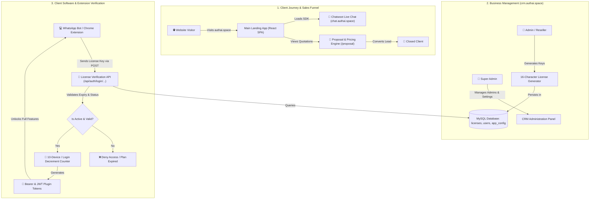

# 🚀 AUTH AI — Web & CRM Platform (`authai-web-crm`)

[](https://reactjs.org/)
[](https://vitejs.dev/)
[](https://www.php.net/)
[](https://www.mysql.com/)
[](https://www.chatwoot.com/)
[]()

> **Comprehensive Web Ecosystem & Backend Licensing CRM for WhatsApp Automation, AI Chatbots, and Digital Growth Services.**

---

## 📌 Executive Summary & Concept

**AUTH AI** (`authai.space`) is an AI-powered customer acquisition and WhatsApp marketing automation company. This repository contains the complete production-grade web infrastructure powering the business, structured into three coordinated modules:

1. **Main Landing Application (React SPA):** High-converting marketing portal showcasing AI bot solutions, case studies, interactive video demos, and an integrated **Chatwoot live-chat widget**.
2. **Proposal & Dynamic Pricing Portal (React SPA):** Dedicated interactive platform for prospective clients to evaluate automation tiers, custom feature sets, and pricing quotations.
3. **License & Reseller CRM Engine (PHP + MySQL):** Full-featured multi-tier administrative dashboard with Role-Based Access Control (**Super Admin**, **Admin**, **Reseller**) and external REST API endpoints to authenticate, rate-limit, and manage licenses for WhatsApp automation Chrome extensions and desktop tools.

---

## 🏗️ System Architecture & Workflow



---

## 📂 Repository Structure

```text
authai-web-crm/
├── public_html/
│   ├── assets/                         # Compiled assets for main React Landing app (JS/CSS)
│   ├── cctv_images/                    # CCTV demo snapshots & marketing media
│   ├── cctv_vid/                       # Generated video clips & product demos
│   ├── crm.authai.space/               # ⚙️ Full PHP/MySQL Backend CRM & License System
│   │   ├── api/                        # REST API handlers
│   │   │   ├── auth/login/             # Dynamic license verification endpoint for client software
│   │   │   ├── admin_api.php           # Admin CRUD operations
│   │   │   ├── reseller_api.php        # Reseller management endpoints
│   │   │   ├── license_api.php         # License generator, status toggler & deleter
│   │   │   └── settings_api.php        # System configuration handler
│   │   ├── assets/                     # CRM icons, logos, and UI assets
│   │   ├── include/
│   │   │   ├── config.php              # Database connection, security helpers & timezone
│   │   │   └── message_toast.php       # Dynamic notification toast component
│   │   ├── modals/                     # Reusable Bootstrap/Tailwind modals
│   │   ├── sections/                   # Header, navbar, sidebar, and footer partials
│   │   ├── admins.php                  # Super-admin portal to manage administrator accounts
│   │   ├── dashboard.php               # Metrics dashboard (active/expired licenses, counts)
│   │   ├── index.php                   # Session-aware router (redirects to login or dashboard)
│   │   ├── licenses.php                # Master license management table & action center
│   │   ├── login.php / logout.php      # User authentication system
│   │   ├── resellers.php               # Reseller account manager
│   │   ├── setting.php                 # Global system configuration panel
│   │   └── test.php                    # Password hash verification utility
│   ├── Images/                         # Brand badges, Meta partner assets, dashboard screenshots
│   ├── outer-home/                     # Static flowcharts, WhatsApp mockups & banner assets
│   ├── proposal/                       # 📑 Client Proposal & Interactive Pricing React SPA
│   │   ├── assets/                     # Compiled Vite bundles (Pricing, Home, workflow chunks)
│   │   ├── .htaccess                   # Apache URL rewrite rules for proposal SPA routing
│   │   └── index.html                  # Proposal app mount point
│   ├── .htaccess                       # Apache routing, HTTPS enforcement & SPA fallback
│   ├── favicon.svg                     # Official brand favicon
│   ├── icons.svg                       # SVG sprite sheet
│   └── index.html                      # Main entrypoint with Chatwoot SDK integration
├── .gitignore                          # Standard git ignore definitions
└── README.md                           # Master architectural and deployment documentation
```

---

## 🧩 Deep Dive into Modules

### 1. Main Landing Website (`public_html/index.html`)
* **Technology:** React SPA compiled with Vite.
* **Integrations:**
  * **Google Tag Manager (`GTM-W2MHKM4X`)** for analytics and conversion tracking.
  * **Chatwoot Live Chat SDK (`chat.authai.space`):**
    ```javascript
    window.chatwootSDK.run({
      websiteToken: 'rttNA5aCQZzkWkqgeT7Bw99b',
      baseUrl: 'https://chat.authai.space'
    });
    ```
  * Custom font pairing with *Plus Jakarta Sans*, *DM Sans*, and *JetBrains Mono*.

---

### 2. Proposal & Pricing Portal (`public_html/proposal/`)
* **Technology:** Isolated React application with client-side routing.
* **Purpose:** Allows the sales team to share clean, interactive proposals detailing automation workflows, lead capture bots, and CRM sync features with transparent pricing tiers.

---

### 3. License & Reseller CRM (`public_html/crm.authai.space/`)
* **Role-Based Access Control (RBAC):**
  * `super_admin`: Full access to system settings, admin accounts, reseller accounts, and global license metrics.
  * `admin`: Manage designated resellers and generate client licenses.
  * `reseller`: Generate and manage client software keys under assigned quota.
* **License Generation Logic:**
  * Generates random 16-character keys formatted as `XXXX-XXXX-XXXX-XXXX`.
  * Tracks client name, mobile, email, status (`active`, `expired`, `blocked`), and expiry date.
* **Device / Login Limitation Algorithm:**
  * Uses the `device_id` column as a persistent decrementing counter (enforcing a maximum of 10 logins/activations per key).
  * Automatically blocks access once the quota reaches `0`.

---

## 🗄️ Database Schema (MySQL)

To setup the backend database, run the following SQL schema in your MySQL instance:

```sql
CREATE DATABASE IF NOT EXISTS `u475921093_crm` DEFAULT CHARACTER SET utf8mb4 COLLATE utf8mb4_unicode_ci;
USE `u475921093_crm`;

-- 1. Users Table (Super Admin, Admins, Resellers)
CREATE TABLE IF NOT EXISTS `users` (
  `id` INT AUTO_INCREMENT PRIMARY KEY,
  `username` VARCHAR(100) NOT NULL UNIQUE,
  `name` VARCHAR(100) NOT NULL,
  `password` VARCHAR(255) NOT NULL,
  `role` ENUM('super_admin', 'admin', 'reseller') NOT NULL DEFAULT 'reseller',
  `parent_id` INT DEFAULT NULL,
  `created_at` TIMESTAMP DEFAULT CURRENT_TIMESTAMP,
  INDEX (`parent_id`),
  INDEX (`role`)
) ENGINE=InnoDB DEFAULT CHARSET=utf8mb4;

-- 2. Licenses Table
CREATE TABLE IF NOT EXISTS `licenses` (
  `id` INT AUTO_INCREMENT PRIMARY KEY,
  `license_key` VARCHAR(64) NOT NULL UNIQUE,
  `software_name` VARCHAR(100) NOT NULL,
  `client_name` VARCHAR(100) NOT NULL,
  `client_mobile` VARCHAR(20) DEFAULT NULL,
  `client_email` VARCHAR(100) DEFAULT NULL,
  `created_by` INT NOT NULL,
  `status` ENUM('active', 'expired', 'blocked') NOT NULL DEFAULT 'active',
  `expiry_date` DATE DEFAULT NULL,
  `device_id` VARCHAR(50) DEFAULT NULL,
  `created_at` TIMESTAMP DEFAULT CURRENT_TIMESTAMP,
  INDEX (`created_by`),
  INDEX (`status`),
  INDEX (`license_key`)
) ENGINE=InnoDB DEFAULT CHARSET=utf8mb4;

-- 3. Application Configuration Table
CREATE TABLE IF NOT EXISTS `app_config` (
  `id` INT AUTO_INCREMENT PRIMARY KEY,
  `config_key` VARCHAR(100) NOT NULL UNIQUE,
  `config_value` TEXT DEFAULT NULL
) ENGINE=InnoDB DEFAULT CHARSET=utf8mb4;

-- 4. Initial Super Admin Account (Password: 123456)
INSERT INTO `users` (`username`, `name`, `password`, `role`)
VALUES ('admin', 'Super Admin', '$2y$10$fWJ8a4aT.MekcIeK4R48k.kMZZd5h3wWwU9nNl1kX1A9.OaN0.P6.', 'super_admin')
ON DUPLICATE KEY UPDATE `username`=`username`;
```

---

## ⚡ How to Run Locally

### Prerequisites
- **PHP** (8.0 or higher with `mysqli`, `json`, `mbstring` extensions)
- **MySQL / MariaDB** (5.7 or higher)
- **Python 3** or **Node.js** (for serving static frontend bundles)

---

### Step 1: Run the Main Website & Proposal Portal
The landing page and proposal sections are pre-compiled static bundles. You can serve them using any HTTP server:

```bash
# Navigate to the web root
cd public_html

# Option A: Using Python built-in server
python3 -m http.server 3000

# Option B: Using Node.js serve
npx serve . -p 3000
```
- Main Landing: [http://localhost:3000](http://localhost:3000)
- Proposal App: [http://localhost:3000/proposal/](http://localhost:3000/proposal/)

---

### Step 2: Configure & Run the PHP CRM

1. **Update Database Credentials:**
   Edit `public_html/crm.authai.space/include/config.php`:
   ```php
   $host = "localhost";
   $user = "your_mysql_user";     // e.g. root
   $pass = "your_mysql_password"; // your password
   $dbname = "u475921093_crm";    // your database name
   ```

2. **Start the PHP Built-in Server:**
   ```bash
   php -S localhost:8000 -t public_html/crm.authai.space
   ```

3. **Access the CRM:**
   - Open [http://localhost:8000/login.php](http://localhost:8000/login.php)
   - Default credentials:
     - **Username:** `admin`
     - **Password:** `123456`

---

## 🌐 Production Deployment (Apache / cPanel / Hostinger)

1. **Upload Files:** Upload the entire contents of `public_html/` directly into your web server's `public_html/` directory.
2. **Setup Subdomain:** Configure a subdomain for `crm.authai.space` pointing directly to the folder `public_html/crm.authai.space/`.
3. **Database Import:** Create a MySQL database in cPanel/Hostinger and import the SQL schema provided above.
4. **Apache Rewrite Modules:** Ensure `mod_rewrite` is enabled on Apache so that `.htaccess` SPA fallbacks and pretty URLs work properly.

---

## 🔒 Security Recommendations

- **Environment Separation:** Keep production database passwords out of version control; consider moving credentials to an environment file (`.env`) or a config file outside the public web root.
- **HTTPS Enforcement:** Always ensure SSL is enabled in production (already enforced via `public_html/.htaccess`).
- **Endpoint Protection:** The auth verification endpoint (`api/auth/login/...`) utilizes parameterized SQL queries (`$conn->prepare`) to protect against SQL injection.

---

## 📄 License & Attribution

Developed for **AUTH AI** (`authai.space`). All rights reserved. Built with integration for Chatwoot Open Source Customer Engagement Suite.
